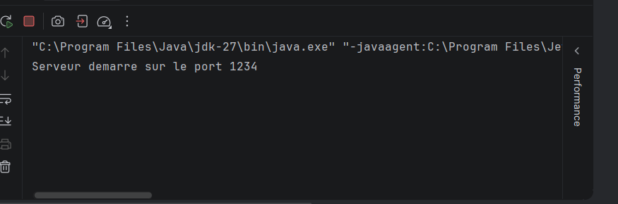
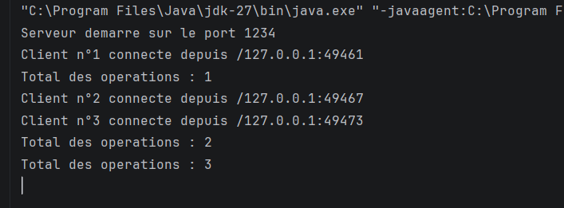
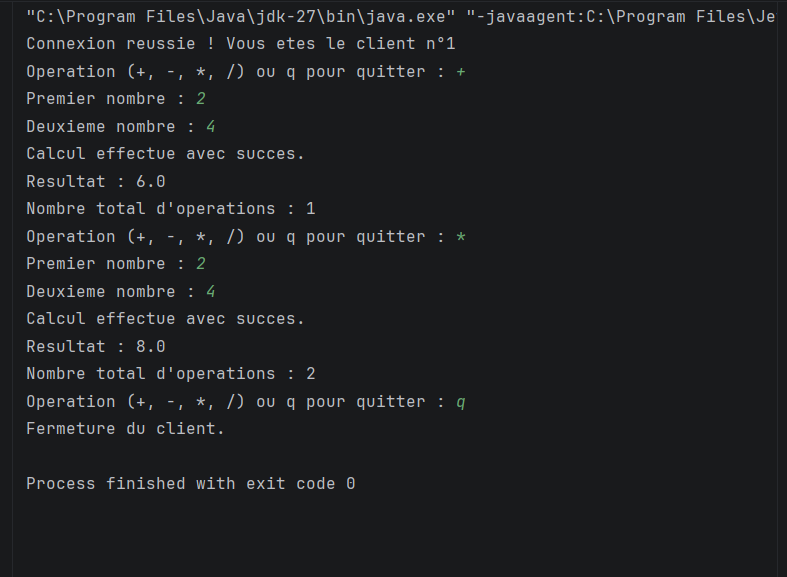

# TP3 – Serveur Multi-threads

**Matière :** Développement d’applications réparties  
**Niveau :** LSI 3  
**Année universitaire :** 2026–2027

## 1. Objectif du TP

L'objectif de ce TP est de développer un serveur Java capable de gérer plusieurs clients simultanément à l'aide des sockets TCP et des threads.

Le travail comprend deux activités :

- **Activité 3-1 :** Acceptation de plusieurs clients et attribution d'un numéro de connexion à chacun.
- **Activité 3-2 :** Amélioration de l'application calculatrice avec une communication par objets et un compteur global d'opérations.

## 2. Architecture du projet

Le projet est organisé en trois packages :

- `serverPackage` : contient le serveur et le traitement des clients.
- `clientPackage` : contient le programme client.
- `commonPackage` : contient les classes `Request` et `Response`, utilisées pour échanger des objets Java.

## 3. Fonctionnement

Le serveur écoute sur le port 1234. Lorsqu'un client se connecte, le serveur lui attribue un numéro et crée un thread dédié.

Le client peut envoyer une demande de calcul. Le serveur traite la demande et renvoie une réponse contenant le résultat.

Un compteur partagé indique le nombre total d'opérations réussies. Son accès est synchronisé afin de garantir la cohérence des incrémentations entre les threads.

## 4. Tests réalisés

### Test 1 : Démarrage du serveur

Cette capture montre le démarrage du serveur avant la connexion des clients. Le serveur est en attente de nouvelles connexions sur le port 1234.

### Test 2 : Connexion de plusieurs clients

Cette capture montre le serveur après la connexion de trois clients. Chaque client reçoit un numéro de connexion et possède un thread dédié.

### Test 3 : Résultat d'un client

Cette capture montre l'exécution du programme client et le résultat obtenu après une demande de calcul.

### Test 4 : Serveur après la connexion d'un client

Cette capture montre l'évolution de la console du serveur après la connexion d'un premier client.

## 5. Synthèse

Ce TP m'a permis de comprendre le fonctionnement d'un serveur multithread en Java, la communication client/serveur par sockets TCP, l'échange d'objets sérialisés et la gestion d'une ressource partagée entre plusieurs threads.

Les tests réalisés permettent de vérifier le démarrage du serveur, la connexion de plusieurs clients simultanément et l'exécution des opérations de la calculatrice.

